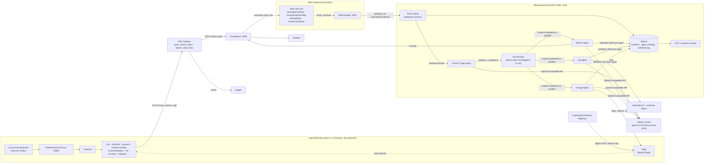
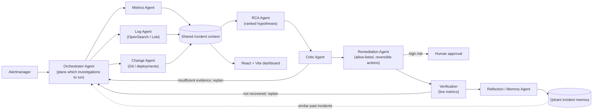

# AIRA: mid-semester architecture

This document describes **what is built and running now**, then, in a separate section, what comes
next. Every component in the first diagram exists in this repository and was verified with real
faults on 2026-10-06.

## 1. What is built now

### The investigation (Phase A)

After triage, the **Orchestrator** plans the investigation rather than running a fixed pipeline.

| Signal on the alert | Investigators run | Skipped, and why |
|---|---|---|
| `error_rate`, `operation_errors` | metrics, log, change | – |
| `cpu` (or triage says `resource_saturation`) | metrics, change | **log** — CPU saturation is a resource problem; logs rarely explain it |
| `availability` (or `service_unavailable`) | metrics, change | **log** — the service stopped logging before the incident |

Every skipped agent is stored with its reason and shown on the console, so the decision is visible
rather than implied.

Planning is deterministic rather than a further LLM call: the choice has to be explainable and
repeatable, and an extra model call would cost ~7 s of the ~45 s budget to reproduce what four rules
already express. It becomes a model decision in the later replanning phase, where the next step
depends on what the Critic found and cannot be reduced to a table.

**Parallel where it is free, serial where it is not.** All three investigators' evidence is gathered
concurrently — Prometheus, OpenSearch, container stdout and Docker inspection are I/O and cost no GPU
(measured: 0.6–1.9 s for three sources). The reasoning is then serialised, because one local model
serves every agent and 1.4 GB of spare VRAM cannot hold a second.

| Agent | Evidence source | Typical runtime |
|---|---|---|
| Triage | Prometheus evidence | 7–14 s |
| Metrics | `prometheus_tool.py` | 7–10 s |
| Log | OpenSearch + `docker logs`, merged and de-duplicated | 4–7 s |
| Change | flagd OFREP, container restarts, image versions | 5–8 s |

Measured end to end: **17–28 s** per incident for a full investigation.

### Data flow for one incident

1. **Fault:** `inject-fault.ps1` changes a flag through the flagd-ui API (or stops a container).
   `flagctl.py` asks flagd itself which variant it is now serving, confirming the fault is live.
2. **Signals:** services export spans and metrics over OTLP. The collector turns spans into
   `traces_span_metrics_*` (request rate, errors, latency per service and operation) and reads container
   CPU and memory from the Docker socket.
3. **Detection:** Prometheus evaluates the four AIRA rules every 15 s. Each rule has a short `for:`
   (15–30 s) so an alert is pending first, then firing.
4. **Notification:** Alertmanager groups by `alertname` + `service_name` and posts its standard webhook
   (payload version 4) to `http://host.docker.internal:8000/alerts`, including `resolved` notifications.
5. **Incident:** the backend logs the raw payload and creates one incident per alert instance
   (fingerprint + `startsAt`). A `resolved` notification updates the same incident.
6. **Evidence:** a background task runs the Prometheus tool for the alert's `service_name`: request rate,
   error ratio, p95 latency, container CPU and memory, the time since the container last reported, the top
   failing operations, and a 15–25-minutes-ago baseline for each. A missing value is written as
   "unavailable".
7. **Triage:** the CrewAI Triage Agent (one agent, one task) receives the alert and the evidence text. It
   must answer with JSON containing `summary`, `affected_service`, `observed_symptoms`,
   `likely_cause_category`, `suggested_next_investigation` and `confidence`. Pydantic validates the
   answer. Invalid output gets one retry with the validation error; a second failure is stored as an
   error state. Runs are serialised (one at a time) and time out after 180 s.
8. **Console:** `GET /` polls `GET /incidents` every 3 s and shows status, times, evidence and the
   agent's summary.

### Key design decisions

| Decision | Reason |
|---|---|
| Upstream demo never edited; AIRA changes live in `infra/` | Reproducible, easy to upgrade, and it is clear what we built and what upstream built |
| Prometheus config is a copy of upstream plus `rule_files` and `alerting`, mounted by our compose override | Prometheus has no include mechanism for these sections |
| Span metrics for request rate, errors and latency | The only RED metrics emitted uniformly by every service (Go, Java, .NET, Node, Python, ...) |
| CPU from the rate of `container_cpu_usage_nanoseconds_total` | The `container_cpu_utilization_ratio` gauge lagged far behind reality (measured) |
| "Service down" = a container that reported in the last 30 min but not in the last 45 s | Services push OTLP, so there is no `up` metric; docker_stats reports every running container every 10 s |
| Long-lived `*/EventStream` spans excluded from error rules | They end in error when a client disconnects (caused a false flagd alert) |
| Prometheus tool is plain Python, not an LLM tool call | Numbers must be exact and repeatable; the LLM only interprets them |
| Agent output is JSON validated by Pydantic | A structured result can be stored, displayed and later evaluated |
| Shared plumbing in `agents/base.py` | Every agent inherits the same number-discipline rules, JSON parsing and retry, so a prompt fix applies everywhere instead of being copied four times |
| Agents can be given a semantic `check` that forces the retry | The schema cannot express "a flag is listed as not off, so changes_found cannot be false". Prompting alone failed that case; a real check does not |
| Service dependencies read from container environment | Each service declares its callees as `<NAME>_ADDR` variables, so the call graph is read from the running system. Without it the Change agent blamed a payment flag for a cart alert |
| Log evidence merges OpenSearch **and** container stdout | Neither covers the demo alone: of 870k OpenSearch documents only ~2.1k carry a service name, all `payment`; container logs cover cart, recommendation and ad as well |
| Local model on Ollama (qwen2.5:7b-instruct, 4.7 GB) | Zero cost and private. Fits fully in 8 GB of GPU memory: about 7–10 s per triage |
| SQLite | Single file, no extra service, enough for a prototype |

### Components and versions

| Component | Version | Where |
|---|---|---|
| OpenTelemetry Demo | 3.1.0 | `opentelemetry-demo/` (upstream) |
| OTel Collector contrib | 0.159.0 | demo |
| Prometheus | 3.13.1 | demo + `infra/prometheus/` |
| Alertmanager | 0.34.1 | `infra/compose.aira.yaml` |
| FastAPI / Uvicorn | 0.142.2 / 0.54.0 | `backend/` |
| CrewAI | 1.15.23 | `backend/` |
| Ollama / model | 0.9.6 / qwen2.5:7b-instruct (Q4_K_M) | host |

## 2. What comes next (not built yet)

These follow the project synopsis and timeline. None of them exists in the code yet.

| Next step | Builds on what exists now |
|---|---|
| ~~Orchestrator, Metrics, Log, Change agents~~ | **Built.** See section 1 |
| RCA Agent | Reads the shared incident context (`agent_findings`) that the investigators now populate |
| Critic Agent + replanning loop | The Orchestrator already records a plan per incident; replanning adds a second round, which the `round` column on `agent_findings` already allows for |
| Remediation Agent with an allow-list (restart container, reset flag, scale) and human approval | `inject-fault`/`clear-fault` already show the reversible action primitives |
| Verification loop | The same alert rules and Prometheus tool decide "recovered or not" |
| Reflection / Memory with Qdrant | Stored incidents (evidence + outcome) become the retrieval corpus |
| React + Vite dashboard | Replaces the preview console and uses the same `/incidents` API |
| Evaluation: rule baseline vs single LLM vs AIRA without Critic vs full AIRA | `measure_alerts.py` already records repeatable fault timings |
